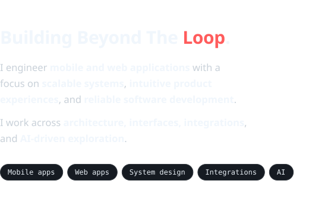

<!-- BANNER -->

  

<!-- QUICK FACTS -->

  

<!-- BADGES -->

  
  
  

 

<!-- 01 · WHOAMI -->
<picture>
  <source media="(prefers-color-scheme: light)" srcset="./assets/h-whoami-light.svg">
  
</picture>

  <picture>
    <source media="(prefers-color-scheme: light)" srcset="./assets/whoami-light.svg">
    
  </picture>
  

