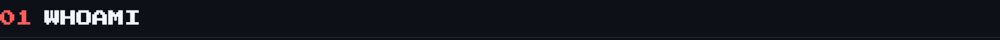
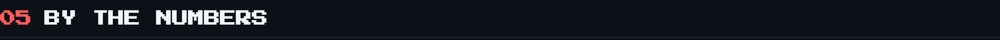
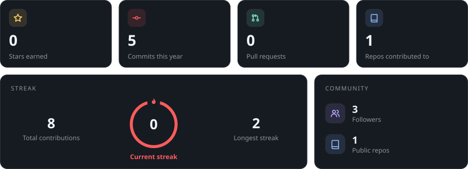

<!--
  ============================================================
  Kalyani Goswami · GitHub profile README
  ------------------------------------------------------------
  Static visuals live in  ./assets/images/
  Live visuals (stats card + Pac-Man) are rebuilt every day by
  .github/workflows/profile.yml and served from the "output" branch.
  ============================================================
-->

<!-- ───────────── BANNER ─────────────
     Pixel night-sky banner with name and roles (stars twinkle, cursor blinks). -->

  

<!-- ───────────── QUICK FACTS ─────────────
     Status · what I'm building · focus · location. -->

  

<!-- ───────────── PROFILE BADGES ─────────────
     Profile views · followers · stars, redrawn daily in the profile's own style
     (see .github/workflows/profile.yml). The tiny hidden image below is the
     visit counter that feeds the "profile views" number. -->

  
  

 

<!-- ───────────── 01 · WHOAMI ─────────────
     Short intro on the left, animated illustration on the right. -->

  
  

 

<!-- ───────────── 02 · OKAY, PING ME ─────────────
     Slim contact pills in one row (icons wiggle gently).
     Links set to "#" are accounts not added yet. -->

  <!-- Email -->
  
  <!-- GitHub -->
  
  <!-- LinkedIn -->
  
  <!-- X -->
  
  <!-- Instagram -->
  
  <!-- Medium -->
  
  <!-- Dev.to -->
  
  <!-- Portfolio -->
  

 

<!-- ───────────── 03 · THINGS I'VE BUILT ─────────────
     Terminal-style list of pinned projects. Clicking opens my repositories. -->

  

 

<!-- ───────────── 04 · MY TOOLKIT ─────────────
     Languages, frameworks, databases & cloud, AI APIs and dev tools (logos bob in a wave). -->

  

 

<!-- ───────────── 05 · BY THE NUMBERS ─────────────
     Both images below update daily (see .github/workflows/profile.yml). -->

<!-- Stats card: stars, commits, PRs, streak, followers -->

  

<!-- Contribution graph for the last 12 months, with Pac-Man eating along one row -->

  

 

<!-- ───────────── 06 · BEYOND CODE ─────────────
     Hobbies: learning Japanese, K-dramas, Clash Royale, chess and Stumble Guys. -->

  

 

<!-- ───────────── FOOTER ─────────────
     Pixel heart and sign-off. -->

  

